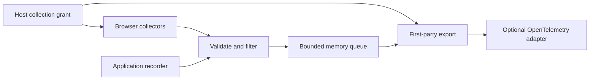

# R02 · Interaction Observatory

**Status** · Local SDK prototype for ELEA 0.1.5

The host application owns collection policy. Alien6 Observe defines a portable
event model and an optional pipeline. ELEA components continue to expose their
existing refs, events and controlled state.

[TypeScript contract](../../../packages/observe/src/contract.ts) · [SDK integration](../../../packages/observe/README.md) · [Typed save example](example.ts)

## Decisions

| Decision | Consequence |
| --- | --- |
| Keep the core independent of ELEA, React and the DOM. | A native HTML application can use the same contract. Qualify one native HTML integration and one ELEA integration before publishing Alien6 Observe. |
| Register semantics explicitly. | A deployment catalog allowlists the surface, component, slot, role, state and variant tuples. A slot identifies a product function such as `document.save`. Presentation and experiment codes are also registered. |
| Validate a closed wire format. | Validate exact keys and catalog combinations before queueing and at ingress. Bound payload size and code cardinality. Use `null` for unknown or inapplicable context. |
| Version the payload and catalog independently. | Increment the wire schema for shape or meaning changes. Revise the catalog when registered codes or collection rules change. |
| Keep assignment, consent UI and analysis in the host. | The host supplies the experiment key, revision and arm. The export contains no assignment, user, device, session, attempt or trace identifier. Timestamps used for dwell stay local. Batch order describes enqueue order. |

## Event semantics

| Event | Collector or recorder | Meaning |
| --- | --- | --- |
| `interaction.activated` | A trusted browser click or an explicit application command. Choose one source per registered action. | Activation of the target. Keep input modality unknown unless the source establishes it. |
| `focus.changed` | Native focus or blur on a registered element. | DOM focus entered or left. An unmatched entry can occur during removal. |
| `exposure.qualified` | `IntersectionObserver` with the viewport root and zero margins, plus a visible-document gate and a catalog dwell rule. | A nonzero-area target met the geometric threshold for the specified interval. |
| `state.transitioned` | The application reports a committed change between two distinct registered states. | Semantic state changed. CSS transition timing describes a separate effect. |
| `task.outcome` | The application reports its terminal success, failure or cancellation criterion once. | The outcome has domain evidence. Silence leaves the attempt unresolved. |

Resolve DOM events against registered element references via `composedPath()`.
For exposure, reset dwell when the document becomes hidden, intersection falls
below threshold, the target is unregistered or the collection grant changes.
Confirm the current state before emitting. Unsupported browser measurements
are omitted. Event Timing can measure responsiveness in a separate pipeline.
[DOM Standard](https://dom.spec.whatwg.org/#dom-event-composedpath) ·
[Intersection Observer](https://www.w3.org/TR/intersection-observer/) ·
[Page Visibility](https://html.spec.whatwg.org/multipage/interaction.html#page-visibility) ·
[Event Timing](https://www.w3.org/TR/event-timing/).

Exposure describes geometry. Gaze requires a separate measurement such as
calibrated eye tracking. Cursor position describes pointer movement.
Keep duration, task completion and reported satisfaction distinct.
[Simons and Chabris](https://www.chabris.com/Simons1999.pdf) ·
[Huang, White and Buscher](https://jeffhuang.com/papers/GazeCursor_CHI12.pdf) ·
[Frøkjær, Hertzum and Hornbæk](https://orbit.dtu.dk/en/publications/measuring-usability-are-effectiveness-efficiency-and-satisfaction/).

## Pipeline

Construction is inert. The implemented pipeline ends at the bounded memory queue. A grant names an approved purpose, event kinds and
destination. Revocation or replacement detaches listeners, cancels observers
and timers, clears pending data and aborts in-flight sends where possible.
Recheck the grant before enqueueing and sending. Start with a bounded local
sink. Optional first-party delivery uses a fixed endpoint, strict ingress
validation and best-effort delivery without persistent retries.

The gateway can map an approved record to an OpenTelemetry LogRecord using
`EventName` under `alien6.observe.*`. Use the gateway reception time as
`ObservedTimestamp` and allowlisted attributes for the two versions and
event details. Disable automatic identity, trace and baggage enrichment for
this pipeline. Clarity and Matomo use richer inputs for heatmaps and replay.
Observe restricts collection to registered event fields at the source.
[OpenTelemetry Logs](https://opentelemetry.io/docs/specs/otel/logs/data-model/) ·
[Browser support](https://opentelemetry.io/docs/languages/js/getting-started/browser/) ·
[Clarity](https://learn.microsoft.com/en-us/clarity/faq) ·
[Matomo](https://matomo.org/faq/heatmap-session-recording/data-masking-in-heatmaps-and-session-recordings/).

## ELEA integration

| Existing entry point | Optional host wiring |
| --- | --- |
| `Button` | Register the native element through a host-owned marker or use the public event callback for an application command. Register `link` for link variants. |
| `SaveStatus` | Report committed state from the host. Emit the task outcome when persistence confirms the save. |
| `TabsRoot` | Use the controlled value for committed selection. The keyboard path can dispatch a programmatic click. |
| `Dialog` | Record the committed open state. Register eligible public elements inside the portal explicitly for DOM collection. |
| Theme and regional density | Resolve effective values at the target, including local and portal overrides. Export registered codes only. |

Keep registration and callbacks in the host adapter. The package graph and
public ELEA component APIs stay unchanged. The typed fixture compares a confirmed save with an unresolved attempt. The
site observatory uses the same contract for a separate opt-in demonstration.

## Production prerequisites

Exclude form values, keystrokes, labels, DOM data, URLs, coordinates,
screenshots, replay and implicit identifiers. Review sensitive slot codes
and infrastructure metadata, including IP addresses and headers. Assess
terminal access separately under ePrivacy Article 5(3) and French Article 82
where applicable. Obtain prior consent for in-scope operations unless a
specific exception is documented. Assess exemption conditions for the actual
purpose and configuration, including audience measurement.
[Article 82](https://www.legifrance.gouv.fr/loda/article_lc/LEGIARTI000037813978) ·
[EDPB Guidelines 2/2023](https://www.edpb.europa.eu/system/files/documents/2024-10/edpb_guidelines_202302_technical_scope_art_53_eprivacydirective_v2_en_0.pdf) ·
[CNIL audience measurement](https://www.cnil.fr/fr/cookies-solutions-pour-les-outils-de-mesure-daudience).

For personal data, document the controller, legal basis, disclosures,
retention, rights, recipients and transfers. Assess the need for a DPIA and
test opt-in, withdrawal, data rejection and teardown before deployment.
[GDPR](https://eur-lex.europa.eu/legal-content/EN/TXT/?uri=CELEX%3A32016R0679).

## Validate the contract

Run `tsc -p docs/architecture/interaction-observatory` with TypeScript
installed. The typed fixture uses the ES2022 standard library. Run the package lint and
tests to verify the SDK. Network delivery remains a future integration.
