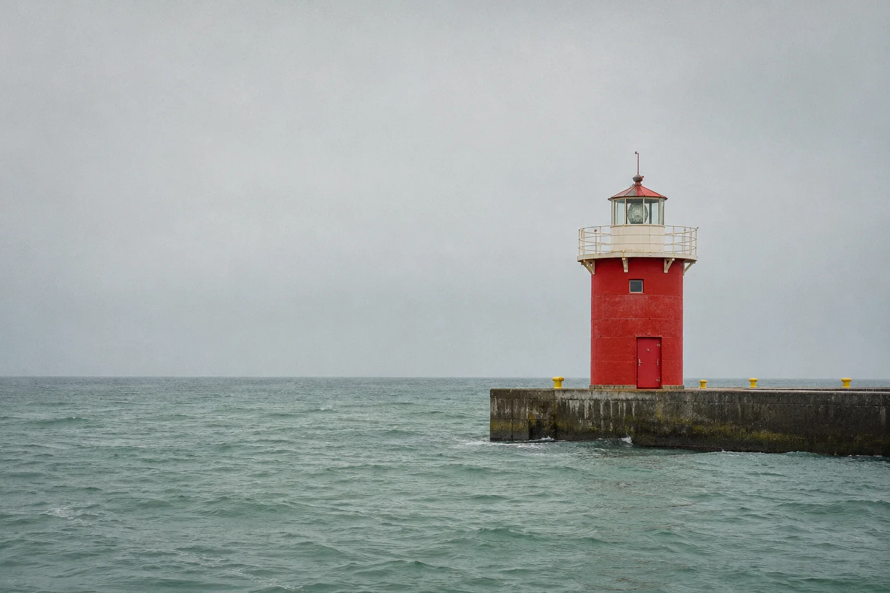

# Composition atlas

*Soundings* is a one-day programme at Quay House. A passer-by needs its name
and date. A visitor at the door needs the room for the afternoon session. What
deserves the most space depends on which person you are designing for.

Each plate sets the same programme on a different grid. The dashed outer
guides mark the inline margins. Dotted outlines mark occupied modules. In
the two unequal grids, the shaded band marks the column gutter. Close
**Construction lines** to see the finished page. Then try finding the room for
the 14:00 session in all three. The proposed advantages await reader testing.

## Axial poster

Construct one full-width field around a central axis. Centre the announcement
on that axis, then subdivide only the timetable into equal tracks. This is a
proposal for an entrance poster where knowing the event’s name comes first.

<figure class="composition-plate">
  

    
Construction lines

    
One axial field. The inline margins each take 4% of the plate width, bounded between 1rem and 2.5rem. Centre the timetable at a maximum of 40rem. From 38rem plate width, divide that timetable into two equal tracks separated by one margin-width gutter.

  

  <article class="programme programme--axial" aria-labelledby="soundings-axial">
    <header class="programme__head">
      
<time datetime="05-17">17 May</time>Quay House

      <h3 class="programme__title" id="soundings-axial">Soundings</h3>
      
A day of listening at the water’s edge.

    </header>
    
    

      

        
<time datetime="10:00">10:00</time>Harbour walk

        
Meet at the east steps for a walk along the breakwater.

      

      

        
<time datetime="14:00">14:00</time>Listening room

        
Meet in the upstairs studio to hear recordings from the quay.

      

    

  </article>
  <figcaption>The large title and the narrower blocks keep the same centre. The local timetable grid fills from left to right and becomes one column below 38rem. Repeating this treatment for a long programme would move the final session far down the page.</figcaption>
</figure>

## Asymmetric spread

Build two unequal tracks and carry their edges through the next row. The
short introduction can give up width to the larger field beside it. Sharing
the tracks with the timetable gives each session an alignment already
established above.

<figure class="composition-plate">
  

    
Construction lines

    
Use the same inline margins. From 38rem plate width, subtract one margin-width gutter and divide the remainder into two and three parts. The schedule spans both tracks. The second session starts on the same edge as the photograph above it.

  

  <article class="programme programme--spread" aria-labelledby="soundings-spread">
    <header class="programme__head">
      
<time datetime="05-17">17 May</time>Quay House

      <h3 class="programme__title" id="soundings-spread">Soundings</h3>
      
A day of listening at the water’s edge.

    </header>
    
    

      

        
<time datetime="10:00">10:00</time>Harbour walk

        
Meet at the east steps for a walk along the breakwater.

      

      

        
<time datetime="14:00">14:00</time>Listening room

        
Meet in the upstairs studio to hear recordings from the quay.

      

    

  </article>
  <figcaption>The second session begins on the same edge as the illustration. Below 38rem, both rows use a single track in source order. For a long introduction, check the depth of the first row before committing to a two-fifths text measure.</figcaption>
</figure>

## Programme index

Reserve one track for the identity and let the schedule span two rows in the
other. Give each session the same internal arrangement for time, name and
disclosure. This is a candidate for a visitor who already recognises the
event and needs to choose where to go.

<figure class="composition-plate">
  

    
Construction lines

    
Keep the margins and column gutter of the spread. Change the track ratio to 1:2 and the row gutter to 1rem. The right module spans both rows. Inside it, each session starts with a time of identical digit width followed by space for a variable-length name.

  

  <article class="programme programme--index" aria-labelledby="soundings-index">
    <header class="programme__head">
      
<time datetime="05-17">17 May</time>Quay House

      <h3 class="programme__title" id="soundings-index">Soundings</h3>
      
A day of listening at the water’s edge.

    </header>
    
    

      

        
<time datetime="10:00">10:00</time>Harbour walk

        
Meet at the east steps for a walk along the breakwater.

      

      

        
<time datetime="14:00">14:00</time>Listening room

        
Meet in the upstairs studio to hear recordings from the quay.

      

    

  </article>
  <figcaption>Opening a session adds depth to its row and leaves the time column in place. Below 38rem the spanning module returns to normal flow. The times retain their shared edge. The shorter identity section leaves more room for the next entry.</figcaption>
</figure>

The 38rem breakpoint belongs to these specimens. To adapt an index for a
museum guide or a departure board, start with the longest title, the widest
time and the full meeting note. Enlarge the type. Fold the columns where those
items begin to crowd one another. The shared edge of the times still serves
the lookup task in a single column.

Build a different grid in the [laboratory](laboratory.md), or read how the
[study](../composition-of-interfaces.md) separates track geometry from judgements of harmony.
